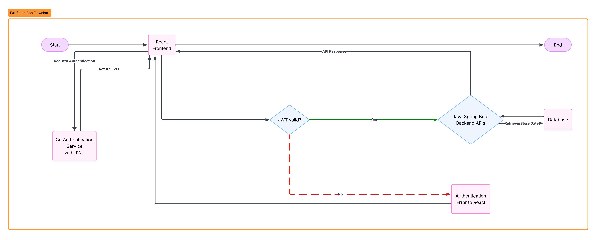
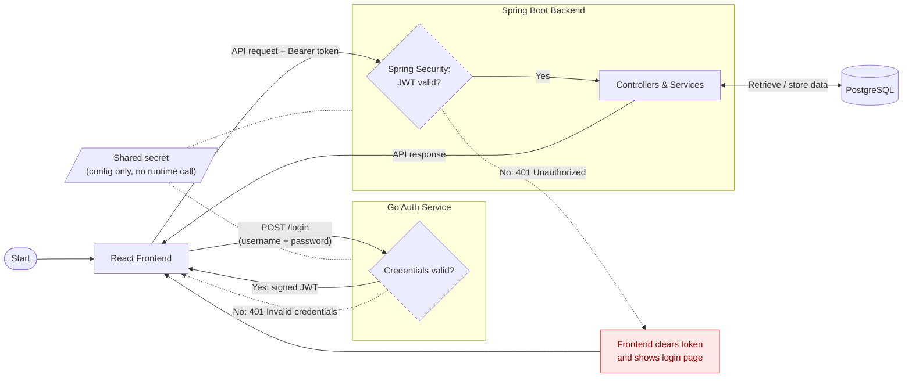

# ExpenseWise Backend (Spring Boot)

This is the backend REST API for ExpenseWise, a simple personal expense tracking application.  
The backend is built with Spring Boot, JPA/Hibernate, and PostgreSQL, and exposes clean CRUD endpoints for Users, Categories, and Expenses.

- Frontend: https://github.com/alicengalice/expense-wise-frontend
- Go Auth Service: https://github.com/alicengalice/go-auth-service/

---

## Tech Stack

- **Java 17**
- **Spring Boot 3**
- **Spring Web**
- **Spring Data JPA**
- **Spring Security** (OAuth2 Resource Server, JWT validation)
- **PostgreSQL**
- **Flyway** (database migration)
- **Lombok**
- **MapStruct** (DTO mapping)
- **Gradle**

---

## Project Structure

- config/     (Security / JWT and CORS configuration)
- controller/ (REST controllers)
- service/    (Service layer) (business logic)
- repository/ (JPA repositories)
- entity/     (JPA entities)
- dto/        (Request/response records and MapStruct mappers)
- exception/  (Global exception handler)
- util/       (Pagination helpers)
- ExpensewiseApplication.java (app entry point + `/health`)
- application.properties   (DB, Flyway and JWT config)

---

## Flowchart


### Authentication flow (detailed)



---

## Database Schema

### User
- `id` (PK)
- `username` (unique)
- `email` (unique)
- `created_at`

### Category
- `id` (PK)
- `name` (unique)
- `description`

### Expense
- `id` (PK)
- `amount`
- `date`
- `description`
- `category_id` (FK → Category)
- `user_id` (FK → User)

---

## Authentication

All `/api/**` endpoints require a JWT issued by the [Go Auth Service](https://github.com/alicengalice/go-auth-service/):

```
Authorization: Bearer <token>
```

- The backend validates the token locally (no call to the auth service): HS256 signature with the shared secret, expiry, issuer (`iss`) and audience (`aud`).
- Missing, expired or invalid tokens get `401 Unauthorized`.
- `GET /health` and CORS preflight (`OPTIONS`) requests are public.
- This is a single-admin tool: any valid token has full access. The `users` table is app data, not login accounts.

---

## API Endpoints

### Health (public)
| Method | Endpoint  | Description |
|--------|-----------|-------------|
| GET    | `/health` | Returns `OK` when the service is up |

---

### Users
| Method | Endpoint          | Description |
|--------|-------------------|-------------|
| GET    | `/api/users`      | Get all users |
| GET    | `/api/users/{id}` | Get user by ID |
| POST   | `/api/users`      | Create new user |
| PUT    | `/api/users/{id}` | Update user |
| DELETE | `/api/users/{id}` | Delete user |

---

### Categories
| Method | Endpoint                  | Description |
|--------|----------------------------|-------------|
| GET    | `/api/categories`          | Get all categories |
| GET    | `/api/categories/{id}`     | Get a category |
| POST   | `/api/categories`          | Create category |
| PUT    | `/api/categories/{id}`     | Update category |
| DELETE | `/api/categories/{id}`     | Delete category |

---

### Expenses
| Method | Endpoint                  | Description |
|--------|----------------------------|-------------|
| GET    | `/api/expenses`            | Get all expenses |
| GET    | `/api/expenses/{id}`       | Get expense by ID |
| POST   | `/api/expenses`            | Create expense |
| PUT    | `/api/expenses/{id}`       | Update expense |
| DELETE | `/api/expenses/{id}`       | Delete expense |

List endpoints support React-Admin style paging and sorting (`_start`, `_end`, `_sort`, `_order`) and return a `Content-Range` header.

---

### Expense Summaries
| Method | Endpoint | Description |
|--------|----------|-------------|
| GET | `/api/expenses/summary/daily/{userId}/{date}` | One day |
| GET | `/api/expenses/summary/weekly/{userId}?startDate=&endDate=` | A range of up to 7 days |
| GET | `/api/expenses/summary/monthly/{userId}/{date}` | The calendar month containing `date` |

Each returns the total amount and expense count for one user. Dates use ISO format (`2026-01-05`).

---

## Running the Backend

### Prerequisites
- Java 17
- PostgreSQL with a database named `expensewise` (on `localhost:5432` by default)
- The [Go Auth Service](https://github.com/alicengalice/go-auth-service/) running, to get tokens

### 1. Set environment variables
Create a `.env` file in the `backend/` directory (it is gitignored):

```dotenv
DB_USERNAME=postgres
DB_PASSWORD=change-me
# Paste a generated secret (see below); identical to the auth service's JWT_SECRET
AUTH_JWT_SECRET=
# Optional; must match the auth service's JWT_ISSUER / JWT_AUDIENCE
# AUTH_JWT_ISSUER=expense-wise-auth
# AUTH_JWT_AUDIENCE=expense-wise-api
```

Generate a random secret (never reuse one from documentation):

```bash
openssl rand -base64 48
```
```powershell
# Windows PowerShell
$b = New-Object byte[] 48; [Security.Cryptography.RNGCryptoServiceProvider]::new().GetBytes($b); [Convert]::ToBase64String($b)
```

These variables are read by `application.properties`. The app refuses to start if `AUTH_JWT_SECRET` is missing or shorter than 32 bytes. Flyway creates the tables on first start.

### 2. Run the project

```bash
./gradlew bootRun        # Windows: .\gradlew bootRun
```

The API runs on `http://localhost:8080`.

### 3. Call the API
Get a token from the auth service, then send it with each request:

```bash
TOKEN=$(curl -s -X POST http://localhost:8081/login \
  -H "Content-Type: application/json" \
  -d '{"username":"admin","password":"your-password"}' | jq -r .token)

curl -H "Authorization: Bearer $TOKEN" http://localhost:8080/api/categories
```

Postman or any HTTP client works the same way.

### Run with Docker
The `Dockerfile` uses a multi-stage build (JDK to build, JRE to run). Point `SPRING_DATASOURCE_URL` at your database when running the image.

```bash
docker build -t expense-wise-backend .
```

### Run the tests

```bash
./gradlew test
```

The context-load test (`ExpensewiseApplicationTest.java`) needs PostgreSQL running; the controller and security tests don't.

---

## Sample Test Data (JSON)

### Create a User
```json
{
  "username": "alice",
  "email": "alice@example.com"
}
```

### Create a Category

```json
{
  "name": "Food"
}
```

### Create an Expense

```json
{
  "amount": 18.50,
  "description": "Lunch",
  "date": "2025-01-05",
  "categoryId": 1,
  "userId": 1
}
```

---
## TODO / Planned Improvements

Completed items are listed under [Improvements](#improvements).

:white_large_square: Improve validation and error handling consistency

:white_large_square: Expand test coverage and add API documentation (e.g. OpenAPI)

:white_large_square: Add charts/graphs to visualise the data

:white_large_square: Add export functionality

---
## Improvements
:white_check_mark: Added pagination and sorting (5th Jan 2026)

:white_check_mark: Added DTO layer (2nd Mar 2026)

:white_check_mark: Added daily/weekly/monthly expense summary (3rd Mar 2026)

:white_check_mark: Refactored the core identity layer from a Java monolith into a decoupled Go-based microservice, implementing stateless JWT authentication so the API validates tokens locally without calling the auth service (10-11 Mar 2026)

:white_check_mark: Added backend Docker containerization with a multi-stage image build and optimized Docker context via .dockerignore (4th May 2026)

:white_check_mark: Fixed health endpoint registration to align security allow-list behavior and improve stack verification during container startup (4th May 2026)

:white_check_mark: Hardened JWT validation with issuer/audience checks and a minimum secret length, and added security tests for valid, missing, tampered and expired tokens (21st Nov 2026)
